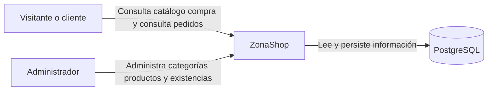
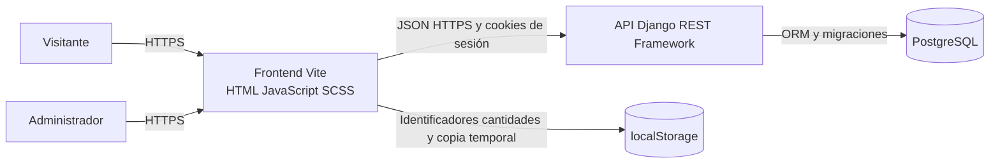
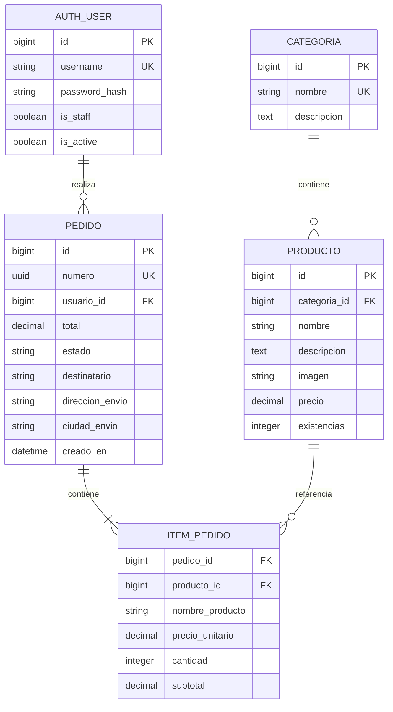

# Arquitectura de ZonaShop

## Alcance de la versión

ZonaShop separa la interfaz web y la API REST en dos proyectos independientes. La versión actual incluye catálogo, administración, autenticación unificada con roles, carrito local y por cuenta, pago simulado e historial de pedidos.

No incluye cobros reales, facturación ni gestión logística. El pago actual es una simulación que nunca transmite datos de tarjeta.

## Contexto C4

## Contenedores C4

## Componentes

### Frontend

- `src/api/`: solicitudes HTTP, credenciales y token CSRF.
- `src/admin/`: formularios y listados administrativos.
- `src/auth/`: inicio, consulta y cierre de sesión.
- `src/carrito/`: cantidades, importes, persistencia y revalidación.
- `src/catalogo/`: presentación y detalle de productos.
- `src/pedidos/`: historial y detalle de pedidos.
- `src/perfil/`: datos personales, dirección principal y contraseña.
- `src/ui/`: notificaciones accesibles compartidas.
- `src/styles/`: estilos SCSS y comportamiento adaptable.

### Backend

- `catalogo/`: categorías, productos, imágenes, existencias y permisos.
- `cuentas/`: autenticación, roles, carrito, pedidos y compra transaccional.
- `config/`: configuración por entorno, seguridad, OpenAPI y rutas.

El directorio `clientes/` permanece inactivo: no está registrado en `INSTALLED_APPS` ni expuesto mediante las rutas del proyecto.

## Modelo entidad relación

El carrito de invitados vive en `localStorage`; al iniciar sesión se fusiona con `ItemCarrito`. El pedido conserva nombre, precio y cantidad históricos aunque el producto cambie o se elimine.

## Flujo de seguridad

1. El frontend solicita `/api/auth/csrf/`.
2. Django establece la cookie CSRF y devuelve el token.
3. El frontend incluye `X-CSRFToken` en operaciones de escritura.
4. El login crea una sesión para clientes y administradores activos.
5. Las consultas del catálogo son públicas.
6. Las escrituras del catálogo requieren rol administrador; carrito y pedidos requieren su usuario autenticado.
7. La compra bloquea filas de producto y confirma stock, totales y descuento en una transacción atómica.
8. En producción, las cookies, HTTPS, HSTS, hosts y orígenes se controlan mediante variables de entorno.

## Decisiones técnicas

| Decisión | Motivo |
| --- | --- |
| Frontend y backend separados | Mantener responsabilidades, dependencias y despliegues independientes. |
| Monolito modular Django | El alcance no requiere microservicios. |
| Sesiones y cookies | Aprovechar autenticación y protección CSRF nativas de Django. |
| PostgreSQL | Persistencia relacional y compatibilidad con el ORM. |
| Carrito híbrido | Permite compra como invitado antes del login y persistencia posterior por cuenta. |
| Pago simulado sin datos sensibles | Probar el flujo completo sin almacenar tarjeta ni CVV. |
| Precios del carrito en centavos enteros | Evitar errores acumulados de coma flotante. |
| OpenAPI con drf-spectacular | Mantener un contrato verificable y Swagger UI. |
| Configuración por variables | Evitar secretos y direcciones específicas dentro del código. |
